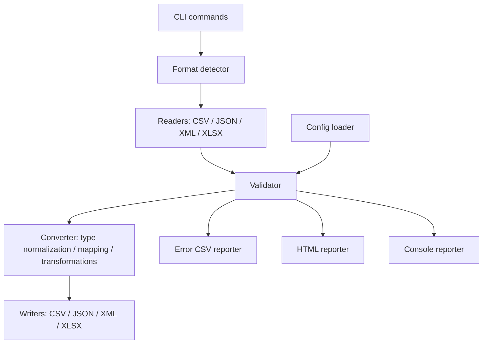

# DataBridge — Architecture

## 1. Architecture Overview

DataBridge uses a modular layered architecture. Each module is responsible for a specific part of the data processing workflow.

## 2. Main Components

### Readers
Responsible for reading source files and converting their contents into JavaScript arrays of records.

Supported readers:
- CSV Reader
- JSON Reader
- XML Reader
- Excel Reader

### Validators
Responsible for checking records against the configuration rules.

Validation results include:
- Valid records
- Invalid records
- Validation errors
- Validation statistics

### Converters
Responsible for:
- Mapping field names
- Transforming field values
- Normalizing validated data types
- Preparing records for output

### Writers
Responsible for saving records in the selected output format.

Supported writers:
- CSV Writer
- JSON Writer
- XML Writer
- Excel Writer

### Reporters
Responsible for:
- Console summaries
- CSV error reports
- HTML validation reports

### CLI
Responsible for parsing user commands and coordinating application modules.

### Utils
Contains shared utilities:
- Format detection
- Error classes
- Logging

## 3. Data Processing Workflow

1. User executes a CLI command.
2. CLI detects the input file format.
3. Reader loads the input file.
4. Configuration is loaded and validated.
5. Validator checks all records.
6. Invalid records are reported.
7. Valid records are mapped and transformed.
8. Writer saves the converted output.
9. Reporters display processing results.

## 4. Architecture Principles

- Single Responsibility Principle.
- Separation of concerns.
- Reusable modules.
- Explicit data flow.
- Centralized format detection.
- Consistent error handling.

## 5. Technology Stack

- Node.js
- JavaScript ES Modules
- Commander
- csv-parse
- csv-stringify
- fast-xml-parser
- xlsx
- js-yaml
- chalk
- date-fns
- Node.js built-in test runner

## 4. Module interaction diagram

